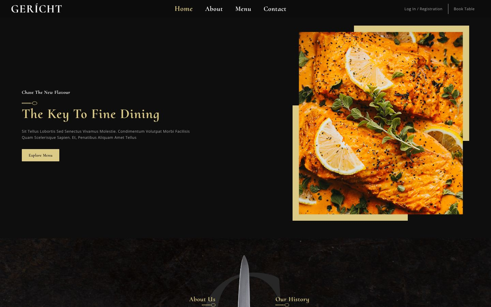
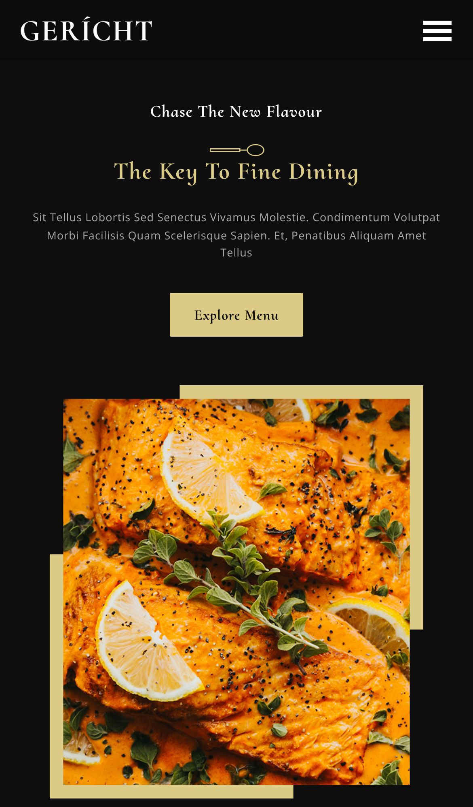
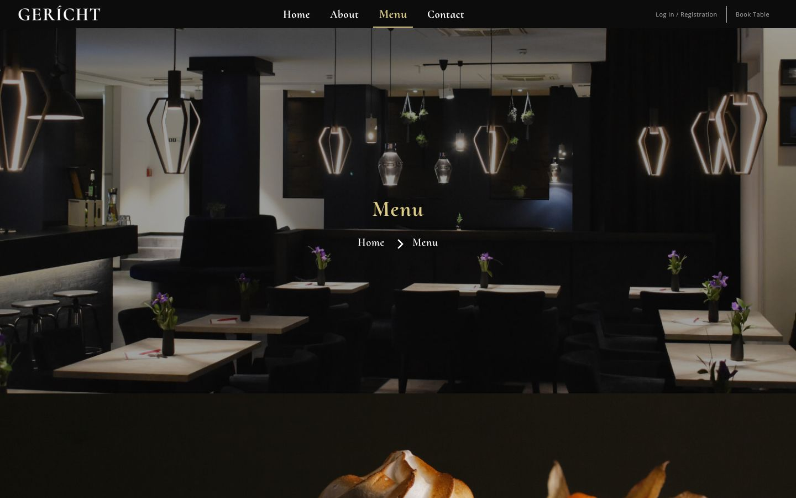

<div align="center">

# Gericht Restaurant

### A four-page fine-dining restaurant website built with React

A dark, gold-accented restaurant site with Home, About, Menu and Contact pages: a hero section, menu lists, a chef's word, awards, a video intro, a scrolling gallery, team and customer sections, and a table-booking form.

[](https://react.dev)
[](https://reactrouter.com)
[](https://react-icons.github.io/react-icons/)
[](https://developer.mozilla.org/en-US/docs/Web/CSS)
[](https://6551386454d2873a0f0e365d--deluxe-pudding-47003d.netlify.app/)

**[Live demo](https://6551386454d2873a0f0e365d--deluxe-pudding-47003d.netlify.app/)** ·
**[Portfolio](https://new-portfolio-ashy-xi.vercel.app/)** ·
**[LinkedIn](https://www.linkedin.com/in/eslamraafat-dev/)** ·
**[Email](mailto:eslamraafat736@gmail.com)**

<br>



</div>

<table>
  <tr>
    <td width="33%"></td>
    <td width="67%"></td>
  </tr>
  <tr>
    <td align="center"><sub>Mobile (iPhone 13)</sub></td>
    <td align="center"><sub>Menu page</sub></td>
  </tr>
</table>

---

## Overview

A **practice project** from my 2023 front-end training. It's based on the popular "Gericht" restaurant landing-page design, which I extended from one page into a **four-page React site** with React Router. I used it to practise component-based layout, reusable section components fed from data files, and small interactive pieces with `useState` and `useRef`. The restaurant and its content are fictional, and some body copy is still placeholder text.

## Pages and sections

| Page | Route | Sections |
| --- | --- | --- |
| Home | `/` | Hero, About Us / Our History, special menu, Chef's word, video intro, Awards, Gallery, Find Us, Footer |
| About | `/AboutPage` | Page header, Our History, Chef's word, video intro, Awards, Footer |
| Menu | `/MenuPage` | Page header, menu slides, Team, Customers, Book a Table form, Happy section, Footer |
| Contact | `/ContactPage` | Page header, contact / suggestion form, Footer |
| 404 | `*` | Not-found page |

## Features

- **Menu data from one file:** wines, cocktails, awards, chefs and customers live in `constants/data.js` and are rendered by shared components (`MenuItem`, `AwardCard`, `SubHeading`).
- **Video intro:** a muted, looping MP4 with a custom play / pause overlay (`useRef` on the `<video>` element).
- **Gallery** with left / right arrow buttons that scroll the image strip.
- **Menu slides:** hovering a menu category swaps the background image.
- **Responsive navbar** with a full-screen mobile menu.
- **Forms** for table booking, newsletter and suggestions. These are front-end UI only; nothing is sent anywhere.

## Tech stack

| Area | Tools |
| --- | --- |
| UI | React 18.2 (Create React App) |
| Routing | React Router 6 (`BrowserRouter`) |
| Icons | react-icons, Remix Icon |
| Styling | Custom CSS, Google Fonts (Cormorant Upright, Open Sans) |
| Hosting | Netlify |

## Project structure

This repository holds the **production build** that is deployed to Netlify. The React source isn't committed here, but the source maps in `static/js/*.map` include it (`Pages/`, `container/`, `components/`, `constants/`).

```
Restaurant/
├── index.html          # CRA entry page
├── static/js · static/css
├── static/media/       # photos, intro video (meal.mp4), icon fonts
├── manifest.json · robots.txt · icons
└── docs/screenshots/
```

## Getting started

The build uses absolute asset paths (`/static/...`) and browser routing, so serve it from the root with an SPA fallback:

```bash
git clone https://github.com/Eslamraafat1/Restaurant.git
cd Restaurant
npx serve -s .     # -s sends /AboutPage, /MenuPage and so on to index.html
```

## Deployment

Deployed on **Netlify**. The demo link above is a Netlify deploy URL. Open the site from the home page and use the navbar; refreshing an inner page on Netlify returns a 404, because no SPA redirect rule is configured.

---

## Author

**Eslam Raafat**, Front-End Developer (React · Next.js · TypeScript)

**[Portfolio](https://new-portfolio-ashy-xi.vercel.app/)** ·
**[LinkedIn](https://www.linkedin.com/in/eslamraafat-dev/)** ·
**[GitHub](https://github.com/Eslamraafat1)** ·
**[Email](mailto:eslamraafat736@gmail.com)**
